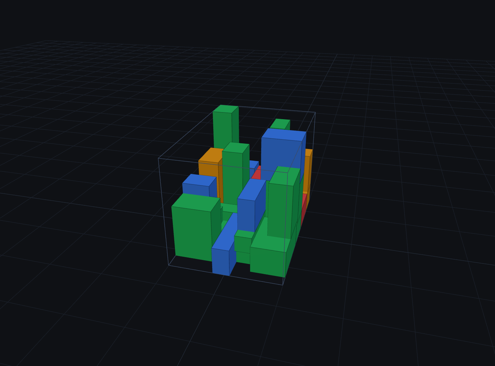

# MBR v3.0 — 3D Bin Packing (Оптимизация загрузки контейнеров)

Веб-приложение для 3D-оптимизации загрузки грузов в контейнеры и фуры. Система автоматически рассчитывает оптимальную укладку коробок с учетом их габаритов, массы, хрупкости и правил логистики (LIFO — порядок выгрузки), после чего визуализирует результат в интерактивной 3D-сцене.



## 🛠 Технологический стек

* **Бэкенд:** Python 3.10+, FastAPI, Pydantic, Uvicorn
* **Фронтенд:** HTML5, CSS3, Vanilla JavaScript (ES6)
* **3D-графика:** Three.js (WebGL)
* **Математическое ядро:** Собственные алгоритмы 3D-упаковки (*Extreme Points, Maximal Empty Cuboids, Backtracking*)

## 🧠 Реализованная архитектура (по ТЗ)

Проект реализует **8 модулей** промышленного алгоритма упаковки:

* **Модуль 1 (Пульс):** Экспресс-отсечение грузов, которые физически не помещаются в кузов.
* **Модуль 2 (Зоны):** Динамическое секционирование кузова по длине в зависимости от порядка выгрузки (*Drop Order*).
* **Модуль 3 (Сортировка):** Приоритизация тяжелых коробок и рандомизация (*Multi-start*).
* **Модуль 4 (Extreme Points):** Генерация опорных точек для укладки коробок вплотную.
* **Модуль 5 (Backtracking):** Рекурсивные откаты (если коробка не влезла, алгоритм удаляет предыдущую и переставляет её).
* **Модуль 6 (Ювелир / MEC):** Поиск максимальных пустых кубоидов (*Maximal Empty Cuboids*) для заполнения пустот.
* **Модуль 7 (Супервизор):** Мультистарт (выполнение 3 попыток с разными настройками параметра *alpha*).
* **Модуль 8 (CBR):** Кэширование успешных упаковок в `cache.json` для мгновенной выдачи результатов при повторных заказах.

## ✨ Дополнительные возможности

* 📁 **Импорт данных:** Загрузка списка коробок из CSV-файла или прямая вставка таблицы из Excel.
* 📸 **3D-снимок:** Сохранение текущего ракурса готовой упаковки в формат PNG.
* 📥 **Экспорт в CSV:** Выгрузка готового плана загрузки с точными координатами (X, Y, Z) для каждой коробки.
* 🛡 **Валидация:** Строгая проверка входящих данных и защита от ввода отрицательных значений.
* ⚡ **Кэширование:** Мгновенный расчет повторных заказов благодаря модулю CBR.

## 🚀 Как запустить проект локально

### Требования
* Установленный **Python 3.9** или выше.

### Пошаговая инструкция

1. Откройте терминал в папке с проектом и создайте виртуальное окружение:
   ```bash
   python -m venv venv
   ```

2. Активируйте виртуальное окружение:
   * **Windows:**
     ```bash
     venv\Scripts\activate
     ```
   * **Mac / Linux:**
     ```bash
     source venv/bin/activate
     ```

3. Установите необходимые зависимости:
   ```bash
   pip install -r requirements.txt
   ```

4. Запустите сервер:
   ```bash
   uvicorn app:app --reload
   ```

5. Откройте веб-интерфейс в браузере по адресу: [http://localhost:8000](http://localhost:8000).

> 💡 **Для пользователей Windows:** Вместо ручного ввода команд в терминале вы можете просто запустить файл `start.bat`.

## 👨‍💻 Автор

Проект разработан в рамках изучения алгоритмов 3D Bin Packing и веб-разработки на Python/FastAPI.
